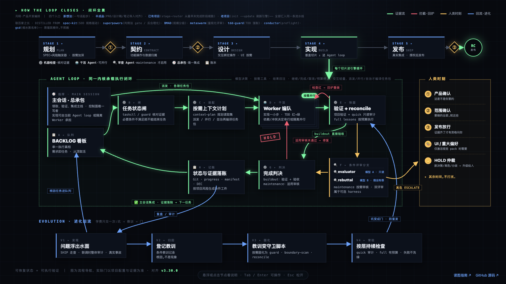

# 闭环架构图怎么读

[打开交互版全景图](https://zzyong24.github.io/product-to-code-orchestrator/) · [返回 README](../README.md) · [下载 HTML 后离线打开](assets/orchestrator-loop.html)

这是一张流程与职责地图，不是部署拓扑。先读顶层阶段，再读中间循环，最后看右侧的人类决策边界和底部的经验回流。HTML 支持悬浮、点击钉住、Esc 关闭说明，也支持 Tab / Enter；无需外部字体或服务。

## 1. 顶层：从目标到交付

| 阶段 | 要解决的问题 | 主要入口 |
| --- | --- | --- |
| PLAN 规划 | 为谁解决什么问题，范围与验收是什么 | `PRODUCT_SPEC.md`、[规划流程](../workflows/v3-1-plan.md) |
| CONTRACT 契约 | 操作、数据归属与接口能否形成真实闭环 | [契约流程](../workflows/v3-2-contract.md) |
| DESIGN 设计 | 实际界面交互是否有操作与数据支持 | [设计流程](../workflows/v3-3-design.md) |
| BUILD 实现 | 当前依赖就绪的任务如何实现与验证 | [实现流程](../workflows/v3-4-build.md) |
| SHIP 交付 | 整体旅程、证据和发布授权是否满足 | [交付流程](../workflows/v3-5-ship.md) |

这些阶段维护可以恢复的产品事实。它们不要求每个小修改都重新跑完，也不自动授予发布权限。

## 2. 中层：同一个可恢复的任务循环

1. **A 看板**：从依赖就绪的任务开始，核对现有范围和状态。
2. **B 状态闸**：通过任务工具与已启用的 guard 检查进入或结束步骤的条件。
3. **C 上下文**：`context-plan` 返回当前步骤所需的规则与项目资料路径；规则包随项目固定。只有派发、并行或自治时，`context-compile` 才生成任务包。
4. **D 实现**：当前 Agent 可以直接完成任务；有真实收益、无读写冲突且有独立工作区时，才派发 Worker。
5. **E 验证**：运行当前任务的实际验证与适用的机械检查。失败或缺少必要证据不能报完成。
6. **G 完成判决**：`buildout` 以验证、集成和验收收口。`maintenance` 额外核对适用的审核证据。
7. **H 落账**：记录提交、状态与证据，主会话统一集成，下一轮可以继续。

**F 是条件分支。** 稳定基线由用户决定进入 `maintenance` 后才启用适用的正式审核。图中的 evaluator/rebuttal 双评审属于 [Claude CLI 串行 harness](../process/harness/README.md)；它不是所有项目、所有宿主的默认运行方式。正式规格评审的收据则由 `reviewctl` 根据问题与内容绑定计算，不靠模型自己宣称通过。

## 3. 检查分层：不能把 quick 当全量验收

| 检查 | 覆盖 | 不代表什么 |
| --- | --- | --- |
| `project-doctor` | 固定规则包、宿主入口、引用和本地 CI 的迁移诊断 | 远端 required checks 已开启 |
| `reconcile --profile quick --read-only` | 阶段、收据、漂移及静态控制面检查 | lessons、资产示例和跨项目实时验证已经运行 |
| 项目验证与 `reconcile --profile full` | 按配置执行真实验证命令及适用检查 | 任意 shell 已被安全沙箱隔离 |

full 的 lessons 需要项目执行预算和适当隔离；超时、取消或子进程未结清都不能通过。完整说明见[过程层](../process/README.md)。

## 4. 右侧与底部：授权和经验各自有边界

右侧的人类时刻处理产品方向、范围、公共合同、安全、不可逆操作与发布等高影响选择。已有授权继续有效，普通可逆实现不因图上画了一个门就反复确认。并行和发布都以当前授权及实际宿主能力为准。

底部经验回流是“发现问题 → 确认根因 → 形成可验证约束 → 在适用检查中复验”。不是每次观察都增加规则、hook 或文档；已启用的守卫才按其配置持续运行。

## 5. 图、代码与来源

当前 HTML 沿用原闭环页面的三层结构和交互讲解，按 v3.30.0 对齐默认建设模式、条件审核、按需并行与 quick/full 边界。PNG 是此 HTML 在浏览器中的实际截图，供 GitHub README 直接展示。交互版由本仓库 GitHub Pages 发布，源码见 [orchestrator-loop.html](assets/orchestrator-loop.html)。

图帮助理解，实际规则以项目固定版本、配置和可执行检查为准。修改图中节点或说明后，应同步更新 PNG，并核对 README 与本文，避免截图和交互版讲两套流程。
