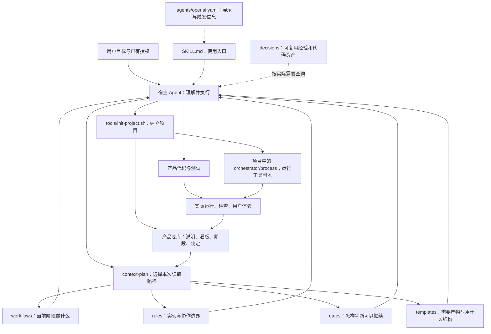
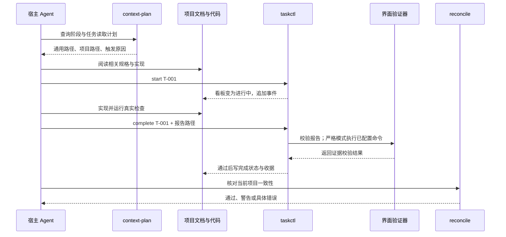

# 从一个日期输入框开始：开发脚手架的完整实操与架构教程

假设你对 AI 说：“做个个人待办工具，能添加待办、选截止日期、标记完成，刷新后不要丢数据。”

你希望得到的可能只是一个输入框、一个日期选择器、一张列表，以及可靠的保存行为。AI 却可能先创建通用表单框架，再封装日历组件，接着加账号系统，最后交出一个刷新就丢数据的漂亮页面。

这套 skill 要解决的，就是让开发始终围绕你的结果推进。本教程会展示：这句话如何变成具体文件，AI 如何读取这些文件，程序检查什么，以及你怎样判断它是否真的做完。

**对应版本：3.30.0。** 文档中的路径、命令、字段和状态值保留原名，解释使用中文。

阅读时区分两类例子：

- **产品案例**：用“日期待办”展示需求、契约、页面、任务和验收应该怎样写。这些是教学样例，仓库没有附带已经实现的待办应用。
- **可运行练习**：在临时目录实际初始化脚手架、查看读取计划、转换任务状态。本文编写时已运行验证；它不需要先安装前端框架。

建议第一次按第一至第六章操作；想理解内部原理，接着读第七至第十章。逐个文件的查找入口见配套的 [模块与文件地图](./skill-file-map.zh-CN.md)。

可以按目的选择阅读路线：

| 你现在想做什么 | 从哪里读起 |
| --- | --- |
| 直接让 Agent 开始开发 | 第一章的完整需求示例 |
| 亲手试一次脚手架 | 第三章初始化 → 第五章任务练习 |
| 看懂一项需求怎样变成文件 | 第四章的五阶段贯穿案例 |
| 看懂 skill 本身怎样运行 | 第二章架构 → 第六、七章加载与调用链 |
| 查某个模块或文件的用途 | 配套的模块与文件地图 |
| 继续项目、加功能或排查异常 | 第十章日常操作手册 |

## 一、先看用户怎么用：一段可以直接发送的需求

在能够访问本 skill 的 Codex 项目中，可以这样说：

> 使用 `$product-to-code-orchestrator`，帮我做一个“日期待办”小工具。
>
> 我自己在这台电脑的浏览器里使用。能添加标题、选择可选的截止日期、标记完成；刷新页面和重新打开后，数据仍在。
>
> 第一版只用中文，不做登录、团队协作、通知推送或云同步。日期先检查已有组件，没有合适的就用浏览器原生日期输入，不另写日历组件。
>
> 按小项目和单项目初始化。普通可逆细节由你决定，持续完成实现与验证。交付时给我启动方法，并实际演示添加、刷新读回、完成、再次刷新保留状态。

这段话已经给出五种关键信息：目标用户、关键操作、数据承诺、范围边界、验收结果。AI 不必再问“是否需要登录”“是否需要英文”，也不能以“产品完整性”为由偷偷加入它们。

如果你还没有准备目录，可以补一句：

> 产品放到我指定的空项目目录，skill 本身的目录只作为方法和工具来源。

这句话很重要。**skill 仓库和你的产品仓库是两个地方。** 前者存放通用规则，后者才存放待办应用的代码。

### 你在整个过程里会看到什么

| 时刻 | AI 应交出的具体结果 | 你重点检查什么 |
| --- | --- | --- |
| 需求整理后 | 待办工具的范围、操作、验收条目 | 有没有理解错，是否增加了账号或提醒 |
| 契约形成后 | 添加、读取、完成三个操作的输入输出 | “保存”到底保存在哪里 |
| 页面形成后 | 空状态、填写、保存成功、失败、完成后的样子 | 能不能顺畅地完成任务 |
| 实现一片后 | 可运行功能、实际检查结果、当前任务状态 | 是否真的保存并能读回 |
| 最终交付时 | 启动命令、真实使用演示、限制 | 刷新后数据和完成状态是否仍在 |

你不需要亲手维护所有 JSON。正常使用时，这些工作由 Agent 执行；教程展示文件，是为了让你能看懂它做了什么。

## 二、认识 skill 的完整架构：每层分别负责什么

这套 skill 由说明文档、模板、脚本和配置协议组成。宿主 Agent 负责阅读和执行；Markdown 本身不会自动运行程序。



例如，“添加截止日期”经过这套架构时：

1. `SKILL.md` 提醒 Agent 先定位产品仓库、识别当前任务。
2. `context-plan.mjs` 根据阶段和任务配置，列出本次要读的文件。
3. BUILD 流程要求完成一个真实用户动作，而不是只画日期框。
4. 公共规则要求先找已有组件、原生能力和已装依赖。
5. 页面契约说明选择日期后如何保存、刷新后如何显示。
6. Agent 修改产品代码并运行测试。
7. 任务工具记录结果，协调检查发现记录与实际文件是否冲突。

**这里有三个不同的“做事者”：Agent 作判断，业务代码实现产品，脚手架脚本管理和核对工程事实。** 不要把“检查脚本返回成功”理解成“用户已经喜欢这个产品”。

### 2.1 skill 仓库的目录地图

下面全部位于 skill 目录，不是待办应用的目录：

```text
product-to-code-orchestrator/
├── SKILL.md                  技能入口、目标、事实归属、加载方式
├── agents/openai.yaml        宿主界面中的名称、说明、默认提示
├── AGENTS_TEMPLATE.md        写入产品仓库的协作入口模板
├── workflows/               五阶段行动说明和公共授权原则
├── prompts/                 恢复工作、初始化、审计、研究交接等专项说明
├── rules/                   数据、界面、架构、并行等边界规则
├── gates/                   各阶段和条件检查的通过标准
├── templates/               项目文档、结构化记录与钩子模板
│   ├── knowledge/           模块、旅程、数据流、证据的模板
│   └── hooks/               宿主事件触发时运行的脚本
├── process/                 状态、加载、验证、研究、协作等运行工具
│   ├── *.config.example.json 配置示例，不等于项目已经启用
│   ├── *.test.mjs           脚手架自身的回归测试
│   └── harness/             Claude CLI 串行执行适配器
├── tools/                   初始化、更新、迁移、自检工具
├── decisions/               技术取舍与可复用资产
│   ├── patterns/            模式卡：例如复用还是自建
│   └── assets/              有来源、有边界的代码资产及候选
├── examples/                脚手架验证样例，不是产品成品
├── docs/                    教程、架构解释与流程图
├── skill_registry.yaml      外部方法参考，不是已安装插件清单
├── VERSION                  当前脚手架版本
└── CHANGELOG.md              历史变化
```

### 2.2 最容易混淆的四种文件

| 种类 | 它回答什么 | 日期待办中的例子 | 不负责什么 |
| --- | --- | --- | --- |
| 流程 `workflows/` | 现在做什么，做完去哪里 | BUILD 先做通“添加并读回” | 不指定必须使用哪个日期库 |
| 规则 `rules/` | 工作时不能破坏哪些边界 | 不用假数据掩盖保存失败；先找原生日期输入 | 不保存本项目的任务进度 |
| 检查标准 `gates/` | 什么证据足以继续 | 刷新后仍读到相同标题与日期 | 不会只因被读取就自动运行浏览器 |
| 模板 `templates/` | 必要文档该写哪些内容 | 契约要写输入、输出、失败、数据来源 | 不要求把每个模板都复制到项目 |

同样是谈“保存”，四者没有各写一套业务事实：流程安排工作，规则约束行为，检查标准说明证明方法，**本项目真正的保存约定写在项目契约里**。

## 三、实际运行一次：初始化究竟产生哪些文件

这一章是可复制执行的练习。它只创建一个新的临时项目，不操作已有产品。

### 3.1 准备工具与目录

需要本地可用的 Bash、Node.js 和 Git。先检查：

```bash
node --version
git --version
bash --version
```

然后指定 skill 的真实位置。下面的默认位置对应本仓库；你的安装位置不同，就修改第一行：

```bash
ORCH_SKILL="$HOME/.skills-manager/skills/product-to-code-orchestrator"
ORCH_LAB="$(mktemp -d "${TMPDIR:-/tmp}/orchestrator-tutorial.XXXXXX")"
ORCH_PROJECT="$ORCH_LAB/todo"

bash "$ORCH_SKILL/tools/init-project.sh" "$ORCH_PROJECT" \
  --triage S --topology single --name "日期待办"

cd "$ORCH_PROJECT"
```

这些变量只是在当前终端保存路径。重新开终端时，需要重新指定它们或进入实际目录。

脚本会在没有 Git 仓库时初始化 Git；仓库还没有任何提交时，会创建初始脚手架提交。因此练习用新目录。如果 Git 提示身份未配置，先按你自己的身份完成 Git 配置再运行。

### 3.2 S、M、L 和 single、multi 是两回事

| 选择 | 回答的问题 | 示例 |
| --- | --- | --- |
| `S` | 能否用简洁总纲和内嵌设计承载当前工作 | 单人日期待办 |
| `M` | 是否已有多块需要分别维护的业务含义 | 客户、跟进记录、导出三个模块 |
| `L` | 是否需要更明确的跨模块架构与独立规格 | 多个复杂业务域组成的平台 |
| `single` | 整体完成是否由一个产品项目负责 | 前后端都在同一项目交付 |
| `multi` | 是否要跨独立版本或部署的项目证明完整旅程 | 网站提交订单，独立服务处理，再由独立客户端展示 |

规模不按页面数机械判断。`M` 不等于必须多仓，`multi` 也不等于要自动开多个 Agent。

### 3.3 初始化后，真实存在的目录

S 类练习会得到下面的主要文件；运行工具目录中的全部脚本在这里省略展开：

```text
日期待办项目/
├── AGENTS.md
├── BACKLOG.md
├── PRODUCT_VOCABULARY.md
├── orchestrator/
│   ├── ARTIFACT_MANIFEST.yaml
│   ├── DECISION_LOG.md
│   └── process/
│       ├── reconcile.config.json
│       ├── .skill-version
│       ├── .vendor-manifest.json
│       ├── context-plan.mjs
│       ├── taskctl.mjs
│       ├── reconcile.mjs
│       └── 其他运行脚本、配置示例和适配器
├── .codex/
│   ├── hooks.json
│   └── hooks/{session-start.sh,backlog-guard.sh}
└── .claude/
    ├── settings.json
    └── hooks/{session-start.sh,backlog-guard.sh}
```

**此时不会出现待办页面、数据库或 `package.json`。`PRODUCT_SPEC.md` 也需要接下来由 Agent 按需求填写。** 初始化创建的是协作起点。

也不会自动创建全套追踪、威胁、研究和范围账本。`*.config.example.json` 是参考样例，存在不表示对应功能已经启用。

### 3.4 逐个解释这几份文件

| 文件 | 谁使用、什么时候读 | 装什么 | 日期待办的具体内容 |
| --- | --- | --- | --- |
| `AGENTS.md` | Agent 进入产品项目时 | 项目级协作入口、阅读和验证约定 | 看板在哪里、每个 BUILD 先运行读取计划 |
| `BACKLOG.md` | Agent 选下一项、用户看进度时 | 任务、顺序、状态、文档链接、验收状态 | T-001 添加并读回；T-002 标记完成 |
| `PRODUCT_VOCABULARY.md` | 写界面文案时 | 产品概念与用户语言 | “待办”“截止日期”“已完成”，不交替叫“工单” |
| `ARTIFACT_MANIFEST.yaml` | 路由与协调检查时 | 当前阶段、产物路径、依赖、门结果 | 当前仍为 `1-plan`，不表示应用已完成 |
| `DECISION_LOG.md` | 有重要选择或恢复上下文时 | 选择、依据、来源和复查条件 | 初始化生成 DEC-000，记录 S 与 single |
| `reconcile.config.json` | 校验器和规划器运行时 | 项目配置、生命周期、证据策略、检查入口 | `buildout`、`interactive`、`program_completion_required: false` |
| `.skill-version` / `rule-bundle/` | 读取通用规则、检查版本时 | 运行时版本、固定规则包及内容哈希 | 优先使用项目包；本机 skill 更新不会改变此项目规则 |
| `.vendor-manifest.json` | 更新工具时 | 已复制运行文件的基线与摘要 | 防止更新覆盖项目中自行改过的脚本 |
| `hooks.json` / `settings.json` | 对应宿主支持事件钩子时 | 宿主事件到脚本的注册 | 会话开始提供队头任务，编辑前做适用检查 |

这里最关键的分工是：**阶段清单管五阶段，任务看板管工作项，决定记录管为什么这样选。** 它们不是三份重复进度表。

### 3.5 查看起点是否正确

在产品项目目录运行：

```bash
node orchestrator/process/delivery-phase.mjs status --root . --json
node orchestrator/process/context-plan.mjs --root . --json
node orchestrator/process/reconcile.mjs --profile quick --read-only --concise
```

你应看到建设模式、规划阶段，以及初始化状态检查通过。S 类的设计阶段可以预先记录为 `compact`，它表示后续设计放在产品总纲里；**它没有把当前阶段跳到 BUILD，也没有替你完成设计**。

`reconcile` 此时通过，只证明“还没开始实现”的记录合理，不能证明“添加待办”已经存在。

## 四、把一句话拆成可用产品：五阶段逐文件示例

下面继续使用日期待办。为便于讲清数据行为，案例选用浏览器本地存储：同一浏览器、同一站点地址保留数据，不支持跨设备同步，清除站点数据会删除记录。这个取舍必须符合用户接受的范围。

实际工程也可以使用已有数据库。脚手架不固定你的技术栈。

### 4.1 规划阶段：`PRODUCT_SPEC.md` 不是一段愿景

Agent 阅读规划流程和产品模板后，应该写出类似下面的具体内容。这里摘出与后续实现有关的核心部分：

```markdown
# 日期待办：产品总纲

## 用户与目标
我自己使用。快速记下要做的事，知道截止日期，完成后留下状态。

## 范围
包含：新增待办、可选截止日期、标记完成、本机保存。
不包含：账号、团队、云同步、提醒推送、复杂日历视图。

## 需求与验收
| ID | 需求 | 验收 |
|---|---|---|
| FR-001 | 添加标题和可选截止日期 | 添加后列表显示同一标题和日期 |
| FR-002 | 标记待办完成 | 状态改变，刷新后仍为已完成 |
| FR-003 | 保留本机数据 | 同一站点重新打开能读回；保存失败不能假装成功 |

## 信息架构
| IA ID | 入口 | 用户在这里做什么 |
|---|---|---|
| IA-001 | 待办主页 | 新增、查看、完成待办 |

- Compact sketch: 顶部新增表单 → 下方待办列表 → 空状态引导新增；
  保存失败保留输入并说明重试；成功后显示新条目。

## 验收条目
- AC-001：新增“提交报销”、日期 2026-10-16，列表正确显示。
- AC-002：刷新后仍有这条待办及同一日期。
- AC-003：标记完成并刷新，仍显示已完成。
- AC-004：空标题不创建记录，输入附近提示“请填写待办标题”。
- AC-005：保存失败时不新增假记录，保留用户已填内容。
```

注意这份文档没有选数据库表名，也没有写 React 组件。它先固定用户结果，避免实现者一边写代码一边改变产品目标。

编号各有用途：`FR` 是需求，`IA` 是用户入口，`AC` 是可观察的通过条件。编号给内部关联用，不显示成页面按钮文案。

**用户此时的检查动作**：搜索“登录”“通知”“团队”“云同步”。如果它们出现在第一版已确认范围里，就要求 Agent 回到原需求解释或删除。

### 4.2 契约阶段：`SERVICE_CONTRACT.md` 说明“按钮后面是什么”

案例不需要网络服务，但本地操作同样需要约定。

```markdown
# 日期待办：操作契约

数据归属：src/todo-store.js 是待办的唯一持久化入口。
界面不在别处自行拼接第二套保存逻辑。
截止日期使用 YYYY-MM-DD 日历日期或 null，不转换为 UTC 时间戳。

| 操作 ID | 操作 | 输入 | 成功 | 失败 |
|---|---|---|---|---|
| API-001 | addTodo | title、dueDate | 保存后返回新待办 | 空标题或存储失败 |
| API-002 | listTodos | 无 | 读回已保存列表 | 损坏数据或读取失败，不伪装空列表 |
| API-003 | setCompleted | id、completed | 保存后的待办 | 不存在的 id 或保存失败 |

addTodo 先完成保存再告诉界面成功。
相同 completed 值重复提交不重复创建待办。
```

这里 `API-001` 是内部操作编号，**不要求把它做成 HTTP 服务**。

再给一条数据样例，能减少“标题叫 name 还是 title”“日期是字符串还是时间戳”的猜测：

```json
{
  "id": "todo-001",
  "title": "提交报销",
  "dueDate": "2026-10-16",
  "completed": false
}
```

这个样例定义结构，不是声称系统已经保存过这条数据。

**用户此时的检查动作**：问 Agent：“关闭浏览器后为什么还在？换浏览器是否还在？保存失败会显示什么？”答案必须与契约一致。

### 4.3 重要取舍：写进 `DECISION_LOG.md`

普通变量改名不必写决策。存储范围会影响用户预期，就值得留下短记录。

下面是**用户已接受本机存储之后**的记录样例；未确认时不能直接照抄 `Owner: user`：

```text
ID: DEC-001
Date: 2026-10-08
Stage: 2-contract
Type: tradeoff
Decision: 第一版使用同一浏览器同一站点的本地存储，不做云同步。
Rationale: 当前仅本人本机使用，无账号与跨设备需求。
Source: 用户对本机保存边界的确认
Affected Artifacts: PRODUCT_SPEC.md, SERVICE_CONTRACT.md
Invalidates: none
Owner: user
Revisit Trigger: 用户需要跨设备或长期备份时
Status: active
```

这份记录的价值在以后：用户要加手机同步时，Agent 能找到原来的选择并修改它，不会以“之前说过本地保存”为理由拒绝新需求，也不会偷偷把原数据丢掉。

### 4.4 设计阶段：日期框只需满足日期选择

先应用最小实现阶梯：

| 问题 | 本例的答案 | 动作 |
| --- | --- | --- |
| 用户是否真的需要选择日期 | 是，明确要求 | 保留需求 |
| 当前工程有合适的输入组件吗 | 新项目没有；旧项目则先查 | 有则复用 |
| 标准库能直接解决界面输入吗 | 不能单独提供界面控件 | 继续检查 |
| 浏览器原生是否满足 | 普通单日期选择满足本例 | 在这里停止选型 |
| 是否还要找依赖、写封装 | 当前没有缺口 | 不继续造日历组件 |

界面骨架可以很小：

```html
<label for="todo-title">待办标题</label>
<input id="todo-title" name="title" required>

<label for="todo-due">截止日期（可选）</label>
<input id="todo-due" name="dueDate" type="date">

<button type="submit">添加待办</button>
```

这段 HTML **只演示输入控件**。完整功能还需要提交、校验、持久化和反馈。原生日期选择器外观会随浏览器和系统变化；如果用户后来明确要求范围选择或一致的复杂日历，再评估现有依赖是否更合适。

S 类可以把视觉草图放进产品总纲。实际界面验收需要的旅程契约仍要按项目要求记录，不能以 `compact` 为由跳过行为验证。

#### `PAGE_SPEC.md` 应说清状态，而不只说“简洁美观”

```markdown
# 待办主页

页面目的：新增、查看和完成待办。

| 前置情况 | 用户操作 | 即时反馈 | 最终结果 | 下一步 |
|---|---|---|---|---|
| 没有待办 | 进入主页 | 显示“还没有待办” | 新增表单可用 | 添加第一条 |
| 标题日期已填 | 点击添加 | 显示正在保存，防止重复提交 | 成功后列表出现新待办 | 继续新增或完成 |
| 标题为空 | 点击添加 | 提示“请填写待办标题” | 不保存，不生成空记录 | 修改标题 |
| 保存发生错误 | 点击添加 | 说明未保存 | 原输入保留，列表不冒充成功 | 重试 |
| 有未完成待办 | 点击完成 | 对应条目更新 | 保存为 completed=true | 继续查看其他待办 |
```

`UI_RULES.md` 记录字体、间距、组件状态和视觉来源；`PAGE_SPEC.md` 记录这个页面的具体操作和状态。两者不要各写一套存储规则，存储继续引用契约。

### 4.5 实现阶段：`BACKLOG.md` 把目标变成任务

任务按可使用的结果拆分，不按“先写所有页面、以后再接数据”拆分。

```markdown
| ID | 任务 | 状态 | 文档 | 审核 | 验收 | 一句话 |
|---|---|---|---|---|---|---|
| T-001 | 添加待办并刷新读回 | 📋 | [主页](PAGE_SPEC.md) | — | 待验 | 表单、保存、列表和错误反馈一并闭合 |
| T-002 | 完成待办并保留状态 | 📋 | [主页](PAGE_SPEC.md) | — | 待验 | 完成后刷新仍保留，覆盖重复操作 |
```

这里的 `—` 表示建设模式不增加正式评审轮次；`待验` 表示界面仍需真实旅程验收。它们是两种状态，不是“都没有检查”。

案例业务代码可以这样组织。这是本例的一种安排，不是脚手架硬性目录规范：

```text
日期待办项目/
├── index.html                  页面入口
├── src/
│   ├── main.js                 把表单和列表接到操作契约
│   ├── todo-store.js           唯一保存与读回入口
│   └── styles.css              项目样式
├── tests/
│   ├── todo-store.test.mjs     校验空标题、保存、读回、完成行为
│   └── todo-journey.spec.js    浏览器里的连续使用验证
├── PRODUCT_SPEC.md             用户结果
├── SERVICE_CONTRACT.md         操作与数据约定
├── PAGE_SPEC.md                页面行为与旅程要求
└── PROJECT_CONTEXT.md          实际启动和验证方法
```

**改一个功能时，哪些文件一起变化？**

以“截止日期不能在刷新后偏一天”为例：

- 契约已经约定日历日期，通常无需修改产品范围。
- `todo-store.js` 修正日期保存/读取处理。
- 对应测试加入“写入 2026-10-16，读回仍为 2026-10-16”。
- 页面验证检查实际显示，而不只检查存储值。
- 看板记录这个修复任务及证据。
- 其他页面的无关样式、登录模块、云同步方案都不应跟着变化。

### 4.6 Agent 怎么知道运行什么测试

`PROJECT_CONTEXT.md` 记录**实际工程已经具备的命令**。假设实现后的项目采用 Node 测试与浏览器旅程测试，它可能写成：

```markdown
# 项目执行上下文

在产品项目根目录运行。

- 启动：使用 package.json 中实际定义的 dev 命令。
- 数据逻辑测试：node --test tests/todo-store.test.mjs
- 浏览器旅程：使用项目中实际配置的浏览器测试命令。
- 人工核对：新增、刷新、完成、再刷新；模拟保存失败检查输入保留。
```

其中 `tests/todo-store.test.mjs` 是应用实现后的示例路径，初始化本 skill 不会自动生成它。Agent 应把说明中的占位改成真正跑过的命令，不能给用户一条不存在的 `npm run dev`。

### 4.7 交付阶段：怎样才算真的完成

本例的最终演示应是一条连续路径：

```text
首次打开空列表
→ 添加“提交报销”，选择 2026-10-16
→ 列表出现正确标题与日期
→ 刷新，数据仍在
→ 标记完成
→ 再刷新，完成状态仍在
→ 尝试空标题和保存失败，反馈符合约定
```

报告应该把结果、证据和限制连起来。下面是**填写结构示例**，结果必须由真实运行补充：

| 验收项 | 实际结果 | 证据位置 | 未解决限制 |
| --- | --- | --- | --- |
| 新增后刷新读回 | 填写观察到的结果 | 实际命令输出或浏览器轨迹 | 是否仅当前浏览器 |
| 完成后刷新保留 | 填写观察到的结果 | 对应测试与运行记录 | 无则明确写无 |
| 保存失败不丢输入 | 填写错误场景结果 | 实际错误注入或测试记录 | 不得用正常场景代替 |

复杂项目分别写 `INTEGRATION_REPORT.md` 和 `RELEASE_REVIEW.md`；简单项目可合并，并同步阶段清单中的实际文件路径。

对严格界面验收，`FRONTEND_VALIDATION_REPORT.md` 还包含机读部分，见第七章。普通文字“以上全部通过”不会自动变成合格收据。

## 五、亲手操作一次任务状态：看到文件真的变化

回到第三章创建的临时项目。这次只练习一个真实的文档任务，**不是把未实现的待办界面标成完成**。

下面命令会替换练习项目的看板，所以只在新建临时目录执行：

```bash
cat > TASK_NOTE.md <<'NOTE'
# 练习说明

本文件用于验证任务状态记录，不代表待办应用已实现。
NOTE

cat > BACKLOG.md <<'BOARD'
# 教程练习看板

| ID | 任务 | 状态 | 文档 | 审核 | 验收 | 一句话 |
|---|---|---|---|---|---|---|
| T-001 | 创建练习说明 | 📋 | [练习说明](TASK_NOTE.md) | — | — | 验证文档任务的状态记录 |
BOARD
```

### 5.1 开始、阻塞、恢复

```bash
node orchestrator/process/taskctl.mjs start T-001
node orchestrator/process/taskctl.mjs block T-001 --reason "演示阻塞转换，不涉及外部服务"
node orchestrator/process/taskctl.mjs resume T-001 --reason "练习说明已就绪，继续验证"
```

实际状态变化为：

```text
📋 → 🔨 → ⏸️ → 🔨
```

每次成功转换既修改看板，又在 `orchestrator/events.ndjson` 追加一条记录。这就是“持久状态”：关闭对话后，变化还在文件里。

### 5.2 先检查真实产物，再完成

```bash
node --input-type=module -e '
import fs from "node:fs";
import assert from "node:assert/strict";
assert.match(fs.readFileSync("TASK_NOTE.md", "utf8"), /练习说明/);
console.log("练习说明存在且内容正确");
'

node orchestrator/process/taskctl.mjs complete T-001 \
  --evidence "已运行 Node 断言，TASK_NOTE.md 存在且包含练习说明"
```

完成后查看：

```bash
cat BACKLOG.md
cat orchestrator/events.ndjson
```

你会看到该任务变成 `✅`，事件依次包含 `start`、`block`、`resume`、`complete`。

这个例子还说明一个限制：**非界面任务的证据文字不是自动验证器。** 如果人或 Agent 编造“已经运行”，工具不可能单凭一句话识破；本练习因此先真正运行文件断言。严格界面任务则有额外的报告、命令和提交绑定。

### 5.3 为什么不用手改一个勾

`taskctl.mjs` 在修改前会检查允许的转换、必要原因或证据，以及适用的研究/评审/界面条件；写入时使用锁和前后摘要，避免拿旧看板覆盖新状态。

但它不会自动替你实现功能，也不会因为 T-001 完成就把整个项目改成 SHIP。任务和阶段继续各司其职。

## 六、读取计划到底有多具体：比较三种真实输出

“按需加载”不是让 AI 随便少读一点，而是根据项目事实返回明确路径。

### 6.1 普通 S 类实现任务：只需五个通用文件

在练习项目中运行：

```bash
node orchestrator/process/context-plan.mjs --root . --stage 4-build --json
```

在没有额外任务配置时，本版的 `required_reads` 是：

```json
[
  "rules/global-rules.md",
  "workflows/_COMMON.md",
  "gates/_GATE_EVIDENCE.md",
  "workflows/v3-4-build.md",
  "gates/13-tdd-gate.md"
]
```

这五个文件分别提供实现选择、授权原则、公共证据、当前行动、实现验证。

`--stage 4-build` 只是在查询这个阶段的读取计划，**不会把清单阶段修改成 BUILD，也不表示前置工作已通过**。

### 6.2 界面任务：在五个文件上增加界面材料

下面是只用于**演示读取推导**的最小模块配置，不是可启动无人值守的完整配置。普通交互任务不必为看例子创建它。

```json
{
  "modules": {
    "todo-ui": {
      "task_id": "T-002",
      "tasks": ["frontend"],
      "context_packs": [],
      "write_set": ["src/ui/**"]
    }
  }
}
```

当此配置位于项目的 `orchestrator/process/modules.config.json`，查询：

```bash
node orchestrator/process/context-plan.mjs --root . \
  --stage 4-build --task T-002 --json
```

规划器从步骤和写入目录识别界面任务，返回的材料包为：

```text
core + build + ui
```

新增四份通用材料：

```text
rules/product-integrity-rules.md
rules/ui-implementation-rules.md
gates/09-frontend-implementation-gate.md
gates/10-frontend-validation-gate.md
```

项目中已有的 `PRODUCT_VOCABULARY.md`、`UI_RULES.md`、`PAGE_SPEC.md` 会进入 `required_project_reads`。尚不存在的文件不会被输出为已存在路径；该任务是否缺少必要规格，仍需要结合流程检查。

### 6.3 M 类项目：多的是架构和知识层，不是所有材料

M 类初始化创建边界和知识配置后，规划阶段实际得到：

```text
core + plan + architecture + knowledge
```

不会因此自动加载资产蒸馏、研究、无人值守和跨项目发布的所有规则。

### 6.4 三个返回字段怎么读

| 字段 | 含义 | 本例的正确使用 |
| --- | --- | --- |
| `read_root` | 通用材料所在的 skill 根目录 | 将它与 `rules/global-rules.md` 拼接后读取 |
| `required_reads` | skill 内的相对路径 | 不到产品项目里寻找这些规则副本 |
| `required_project_reads` | 产品根目录内的相对路径 | 到当前待办项目读取词汇和页面定义 |

输出中的 `total_inline_bytes: 0` 表示规划器只返回路径，不把正文放进 JSON；**不表示 Agent 后面读这些文件不消耗上下文**。`referenced_bytes` 是路径对应文件体积的诊断值。

此外，规划器不是源码依赖分析器。Agent 仍需读取当前任务规格、受影响代码和真实调用方。

## 七、底层逻辑：状态、证据和加载如何串在一起

### 7.1 一次界面任务的实际调用链



图中“执行命令”来自项目配置允许的验证入口，不是任意报告中写一句命令就算运行过。

### 7.2 四份状态各自回答不同问题

| 状态记录 | 问题 | 日期待办的例子 |
| --- | --- | --- |
| `ARTIFACT_MANIFEST.yaml` | 产品目前在哪个阶段 | BUILD，或某份契约因上游变化而失效 |
| `BACKLOG.md` | 哪个用户任务在做 | 添加并读回正在进行 |
| `progress.json` | 已配置队列的哪一步可执行 | 某模块实现已完、验收待做；普通交互项目可没有此文件 |
| `DECISION_LOG.md` | 哪些选择已确定、哪些还缺用户回答 | 本机保存已接受，云同步尚未采纳 |

一个大任务内部可以有多个步骤。中间步骤有提交，任务仍然 `🔨`；不能为了让队列前进，把尚未验收的整项任务提前打勾。

任务事件 `events.ndjson` 是状态转换历史；`RUN_EVENTS.jsonl` 是复盘/复用观察。它们也不是同一个日志：前者解释“谁把任务结束了”，后者可能记录“某次验证出现了值得复盘的故障”。

### 7.3 `reconcile.mjs` 是总核对入口，不是万能测试器

它依据配置组织多种检查，例如：

- 阶段清单是否能解析，引用的产物是否与真实文件和 Git 状态相符。
- 已启用的追踪矩阵有没有断链。
- 正式评审、界面验收和研究状态是否仍然有效。
- 边界、知识文档、范围授权、自治配置是否违反已启用约定。
- 跨项目发布是否具有对应的真实整体证据。

它不会自动为每个业务函数发明测试，也不能用“文件存在”代替浏览器里成功保存。

日常用 `--profile quick --read-only` 核对控制面；它明确跳过 lesson 命令、资产示例和跨项目 fresh verification，不写运行记录。`--profile full` 才执行已配置的完整检查；存在可执行 lessons 时先按实际调用链配置预算、隔离副作用。快速通过不能替代未跑的验证，具体字段见 [过程层说明](../process/README.md)。

**具体例子**：你把 `PAGE_SPEC.md` 改成“完成后隐藏待办”，却继续拿之前“完成后仍留在列表”的旧报告声称通过。规格摘要发生变化，旧证据不能继续充当新行为的证明。

### 7.4 验收收据为什么要绑定哈希

哈希可以理解为一份内容的指纹。它证明“核对的是这份内容”，不证明内容一定正确。

界面验收主要涉及：

| 绑定对象 | 作用 | 能阻止什么误用 |
| --- | --- | --- |
| 当前提交 `commit_sha` | 指明报告实际针对哪个代码版本 | 拿旧代码的结果证明新代码 |
| 页面契约 `contract_sha` | 指明验收条件 | 悄悄修改通过标准 |
| 报告摘要 | 指明完成时登记的那份报告 | 完成后替换报告内容 |
| `watched_paths` | 指明这条旅程真正依赖的代码 | 相关代码变了却继续使用旧收据 |
| 可见文本记录 | 核对真实页面文案与检查点 | 只写一份手抄清单冒充浏览器观察 |

你无需手算这些字段。Agent 使用 [前端报告模板](../templates/FRONTEND_VALIDATION_REPORT_TEMPLATE.md) 和项目命令形成实际报告。下面只是帮助阅读的字段片段，不能直接拿来验收：

```json
{
  "schema": "frontend-validation/v1",
  "task_id": "T-001",
  "contract_path": "PAGE_SPEC.md",
  "contract_sha": "<实际页面契约摘要>",
  "commit_sha": "<实际验证的当前提交>",
  "run": {
    "verify_key": "todo-journey",
    "command": "<项目真实旅程命令>",
    "exit_code": 0,
    "output_ref": "<真实输出位置>"
  }
}
```

报告还有环境、数据样本、检查点、条件覆盖、可见文本及缺陷等字段，以完整模板和验证器为准。

无关文件的新提交不会自动让所有历史报告作废；相关代码、契约或绑定漂移才是重点。严格完成检查仍要求报告绑定完成时实际验证的 HEAD。

### 7.5 规则如何防止上下文越来越大

读取大致分三层：

1. **技能发现**：宿主看技能名称和描述，判断当前请求是否适用。
2. **执行入口**：使用时读 `SKILL.md` 和项目协作入口，知道目标、目录与下一步。
3. **任务材料**：规划器选择阶段与条件材料，Agent 根据依赖继续读取。

`docs/` 教程、历史变更、资产库全量正文、旧故障记录都不应该成为每次执行的必读内容。

旧项目没有 `context_policy` 时，规划器会明确进入兼容读取模式。看到它加载过多，不应随意删除规则文件；先核对项目版本和配置，再按更新流程处理。

### 7.6 钩子是什么，为什么不是“全程自动保护”

钩子是宿主某个事件发生时调用的脚本。

- `session-start.sh`：会话开始时给出队头信息，帮助恢复当前工作。
- `backlog-guard.sh`：在已注册的编辑动作前做适用任务检查。
- `post-tool-observe.sh`、`stop-reconcile.sh`：仓库中保留的更深适配脚本；不是新项目默认全部挂载。

初始化会写对应宿主配置，但实际能否触发取决于宿主是否支持和启用这些事件。直接 shell 或其他编辑途径可能绕过即时钩子，所以完成前的任务工具与协调检查仍有作用。

## 八、项目变大以后：模块如何拆，文件如何分工

假设后来你要做一个客户跟进工具，出现了客户管理、跟进记录和导出三块业务。总纲里继续写所有页面细节，会越来越难找。

此时用 M 类的知识结构。下面在**另一个新目录**演示，不把前面的 S 练习强行迁移：

```bash
ORCH_MODULE_PROJECT="$ORCH_LAB/team"

bash "$ORCH_SKILL/tools/init-project.sh" "$ORCH_MODULE_PROJECT" \
  --triage M --topology single --name "模块示例"

bash "$ORCH_SKILL/tools/init-module.sh" "$ORCH_MODULE_PROJECT" \
  --id FEAT-001 --slug tasks --name "待办管理"
```

实际创建并登记：

```text
docs/
├── INDEX.md                       模块总导航
├── features/
│   └── tasks/
│       ├── README.md               模块是谁、价值、状态、细节入口
│       ├── BUSINESS.md             业务规则、状态、验收
│       ├── DATA.md                 数据来源、归属、写入与关系
│       ├── UI.md                   界面含义、操作与状态
│       └── blocks/                按需放任务证据
├── journeys/                      跨模块的用户旅程
├── data-flows/                    跨模块的数据流
├── platform/                      横切架构与运行约定
├── evidence/                      原始验证证据
└── archive/                       已失效历史
```

工具还会更新 `docs/INDEX.md` 的链接以及 `knowledge.config.json` 的模块映射。它不会仅凭模块名字写出真实业务规则；四个文件中的占位仍需 Agent 填写。

### 8.1 同一个问题应该落哪份文件

以“客户删除后，跟进记录怎么办”为例：

| 要记录的内容 | 正确位置 | 原因 |
| --- | --- | --- |
| 用户是否有权删除，删除意味着什么 | 客户模块 `BUSINESS.md` | 业务规则 |
| 客户与跟进记录怎样关联，谁负责清理或保留 | 对应 `DATA.md`，跨模块时引用数据流 | 数据归属 |
| 确认弹窗如何说明影响 | `UI.md` 或页面契约 | 用户操作与反馈 |
| 从客户列表删除，再到跟进页检查结果 | `docs/journeys/FLOW-*.md` | 跨模块使用路径 |
| 此次删除行为修改的测试输出 | 任务证据或 `docs/evidence/` | 观察结果 |
| 全产品不提供恢复功能这一重要边界 | 产品总纲与决定记录 | 跨模块产品范围 |

不能在每个文件里复制一整段删除规则。业务定义放一处，其余引用，避免修了业务说明却漏改页面副本。

### 8.2 架构说明和边界配置为什么都存在

M/L 项目还会有：

- `orchestrator/SYSTEM_ARCHITECTURE.md`：人和 Agent 阅读的职责说明。
- `orchestrator/process/boundaries.config.json`：扫描器能执行的导入/目录规则。

例如架构说明写“页面不能直接访问服务端数据库”。配置可以禁止界面目录导入数据库包；`boundary-scan.mjs` 能发现某次修改新增了违规导入。

文字负责讲清意图，配置负责表达能检查的那部分。架构改变时同步二者；不要把扫描器检查不到的约束说成已经全面强制执行。

### 8.3 生成文档与人工定义分开

知识文档有性质标记：

| 标记 | 例子 | 怎么维护 |
| --- | --- | --- |
| `canonical` | 当前业务含义 | 在真实需求变化时修订 |
| `derived` | 从契约代码生成的字段事实 | 改源并重新生成，不手修结果 |
| `evidence` | 一次浏览器验证记录 | 保留对应版本和观察 |
| `archive` | 已被替代的旧方案 | 留作追溯，不当成当前要求 |

`feature-sync.mjs` 生成契约事实，`knowledge-drift.mjs` 检测源与生成结果是否脱节，`knowledge-coverage.mjs` 检查必要覆盖，`docs-health.mjs` 检查链接等健康问题。四者有不同职责，不是四个重复审核员。

## 九、按需能力：研究、并行、自治、维护和复用

### 9.1 同一个问题反复修不好：研究门

假设待办同步以后接入外部服务，两次请求结果不同，Agent 一直加重试却说不清原因。

合理的研究任务应具体到：

> 区分“外部服务只保存最后一次请求”和“本地把旧响应覆盖了新状态”。用两个带不同标识的请求记录发送顺序、响应顺序和最终读回结果。结论要能决定修改哪一层。

这时 `research-gate.mjs` 管理观察、暂停和恢复，`TECHNICAL_RESEARCH_CARD_TEMPLATE.md` 提供问题、证据、有限试验和验收的结构。研究只阻塞受影响任务，不要求所有开发停下，也不会把一次普通语法错误升级成研究项目。

### 9.2 两个 Agent 能否同时写：先看依赖，再看目录

假设一个任务修改日期保存格式，另一个任务修改日期显示。即使一个写 `todo-store.js`、一个写 `main.js`，后者仍依赖前者的数据契约；文件名不同不代表可以随意并行。

`progress.mjs` 提供步骤和候选集合，`parallel-isolation.mjs` 核对实际工作区与读写边界，`context-compile.mjs` 输出交接包。

任务包会写清：目标、规格路径、当前步骤、允许读取/修改的范围、共享资源、验证方法、版本锚和受阻处理。`write_set` 是写入范围，`read_set` 是读取依赖，`exclusive_resources` 是必须串行使用的逻辑资源。

只有已授权且独立的工作才委派。主会话负责领取、核对候选和串行集成；工作者不能各自改总看板或推送。

### 9.3 `context-plan` 和 `context-compile` 不要混用

| 工具 | 输入 | 结果 | 什么时候用 |
| --- | --- | --- | --- |
| `context-plan.mjs` | 阶段、项目配置、可选任务/步骤 | 一组应读取的路径与原因 | 普通开发的轻量入口 |
| `context-compile.mjs` | 看板任务、模块绑定、当前步骤、读写和验证配置 | `orchestrator/context/T-xxx.md` 任务包 | 派发、并行或自治需要明确交接时 |

如果编译器提示缺少任务绑定或验证命令，不要填假路径让它通过。先判断是否真的需要任务包；普通交互修改通常不需要。

### 9.4 自治运行不是“换一个模型名就能启动”

本仓库 `process/harness/run.sh` 实际调用 Claude CLI，串行运行任务。Codex/Astra 可在宿主会话里遵循同一流程和工具协议，但给这个 shell 脚本填一个 Astra 名称不会改变其调用通道。

运行器内部的职责是：

| 文件 | 做什么 |
| --- | --- |
| `coding-agent.md` | 一次完成指定步骤、验证、提交、更新步骤 |
| `verify-task.sh` | 运行配置中的验证及适用测试完整性检查 |
| `evaluator.md` | 维护模式的第一轮只读验收 |
| `evaluator-rebuttal.md` | 第二轮寻找相关反例 |
| `run.sh` | 调度、汇总、按实际结论写状态 |
| `settings.autonomous.json` / `risk-hook.sh` | 当前适配器的权限与操作控制 |

建设模式不运行正式评审节拍。维护模式的双重通过也不自动授权发布；高影响事项仍按具体授权处理。开启无人值守前，需要有效模块配置、真实验证命令和执行授权，不能只在决定记录里写“允许自治”就假定一切已配置。

### 9.5 建设与维护是另一条轴

```text
五阶段：规划 → 契约 → 设计 → 实现 → 交付
生命周期：buildout 建设 → maintenance 维护
```

第一次做完日期待办后，它仍可以处于建设模式。用户确认形成稳定基线，才通过 `delivery-phase.mjs promote` 切换维护模式。

维护模式下修改“日期怎样保存”可能影响已有用户数据，因此更重视稳定需求的正式评审和旧行为保护。进入维护不等于每个标点修改都要重新写产品方案；仍按实际影响判断。

### 9.6 跨项目完成：各自通过还不够

如果网站把待办发送到独立同步服务，手机应用再展示它，三个项目分别测试通过不能证明整个链路可用。

`program-gate.mjs` 要把业务旅程、实际部署的版本集合、跨项目步骤和真实结果连起来。协调项目在 `orchestrator/program/` 保存执行拓扑与证据，业务含义仍引用原来的旅程文档。

单项目不用复制这套材料。明确要求跨项目完成时，也不能通过删除配置文件假装不再需要整体验收。

### 9.7 经验怎么留下，又如何避免规则无限增长

例如本次发现“日期字符串不该先变成 UTC 再截回日期”。它先是这个项目的一次修复，未必需要变成每个项目必读的规则。

经验链路分工为：

```text
运行观察
→ RUN_EVENTS.jsonl
→ 显式复盘整理
→ LESSON_INBOX.jsonl / REUSE_OUTBOX.jsonl
→ 核验是否可复用
→ 项目教训、模式卡或候选资产
→ 有证据地维护规则与索引
```

`run-events.mjs` 处理观察记录，`lessonctl.mjs` 管理教训查询/审计，`evolution-guards.mjs` 和 `lessons-stats.mjs` 辅助判断规则是否有用；资产的来源、索引和示例由 `asset-check.mjs`、`assets-runner.mjs` 核对。

`reconcile --consolidate` 是显式整理入口，可能写入观察整理结果并运行配置的反例准备/清理，不能当成普通只读状态查询。

**这不是每次失败都自动改写 SKILL.md 的自我升级。** 候选、库内验证和目标项目验证是不同层次。某个通用重试模块通过了库内示例，也不能直接证明你的待办保存链路已经可靠。

## 十、日常操作手册：遇到具体情况该做什么

### 10.1 第二天继续

可以直接说：

> 继续这个项目。先看当前任务和读取计划，核对已有代码与验证结果，从最上面的依赖就绪项推进。不要重做已经完成的规划。

Agent 应恢复项目文件，而不是根据聊天摘要猜下一步。若出现配置与看板矛盾，先解释具体差异。

### 10.2 加一个功能

例如：

> 增加“只看未完成”的筛选，沿用现有数据，不增加新存储层。筛选后标记完成，该项应从当前列表消失；切回全部仍能看到它。

这句话同时给出需求和容易遗漏的状态联动。通常涉及产品/页面定义、任务、界面代码与相关验证，不需要重建项目或增加新数据库。

### 10.3 检查 Agent 是否过度实现

可以要求：

> 请解释这次每个新增文件分别解决哪个当前需求。先检查项目已有实现、标准库、平台原生能力和已装依赖；删除没有当前用途的封装与配置，但保留必要的错误处理和验证。

不要只要求“把代码压到 50 行”。需要保留的数据错误处理可能比日期输入本身更长。

### 10.4 更新已有项目的脚手架

由本 skill 目录的更新器操作指定产品目录：

```bash
bash "$ORCH_SKILL/tools/init-project.sh" "/你的产品项目绝对路径" --update
```

更新器会核对运行副本基线，保护项目配置、任务、决定和 `AGENTS.md`。如果提示旧项目缺少拓扑，应按实际交付关系补充 `--topology`；不要为了让命令通过随便填 `single`。

规则包也会独立校验；如果项目自己改过运行脚本或包内规则，先审查差异和迁移候选。不要直接覆盖整个 `orchestrator/`，那里还存着项目状态。

更新只运行快速只读审计，并输出 `project-doctor` 诊断。旧 Stop/PostToolUse 和项目自有说明不会因版本号更新就自动变成新配置；按诊断核对失效引用、旧完整检查调用和 CI。采用 GitHub 的项目可加 `--ci github`，已有 workflow 生成合并候选；远端 required checks 需要另外核实。

### 10.5 常见现象对应哪个入口

| 现象 | 先看哪里 | 应采取的动作 |
| --- | --- | --- |
| “初始化成功”，但没有网页 | 初始化只建协作文件 | 继续产品规划和实现，不把初始化当成应用构建 |
| 找不到读取计划中的规则 | `project-doctor.mjs`、规则包、`read_root` | 核对固定包完整性或旧项目本机依赖，通过支持的更新流程修复 |
| 一次读入太多材料 | `context_policy`、规划器的触发原因 | 检查兼容模式和项目级材料包，避免全量复制 |
| 任务不能开始 | 看板审核值、生命周期、具体错误 | 解决真实前置条件，不手改 PASS |
| 界面不能完成 | 报告、命令配置、提交和观察路径 | 运行真实验收并修正绑定，不把“待验”改成破折号 |
| 改文档后旧验收失效 | 契约摘要与受影响行为 | 检查是否改变通过标准，按影响重新验证 |
| 持续修补没有进展 | 失败观察与研究入口 | 用可区分原因的小实验替代继续猜 |
| 两个 Agent 互相覆盖 | 任务依赖、工作区、读写范围 | 隔离写入并由主会话串行集成 |
| 看板越来越难读 | `backlog-health.mjs` | 查看提示，保留执行所需信息，按工具协议整理历史 |
| 改了 skill，产品没跟着变 | 项目运行副本与版本 | 按 `--update` 更新，不假定副本自动同步 |

### 10.6 修改 skill 自身时应验证什么

普通产品任务运行产品的验证命令。只有修改这个 skill，才在 skill 根目录运行：

```bash
bash tools/selfcheck.sh
```

它检查关键入口、脚本语法、运行时回归、运行器失败处理，以及故意植入的断链是否被检测。`examples/selftest-taskflow-lite/control/` 就包含预期失败的数据，用来证明校验器能发现问题；不要把那个失败样例“修绿”。

不要在产品项目中寻找并运行所有 `process/*.test.mjs`：初始化复制运行工具，维护者测试留在 skill 源码侧。

## 十一、检查自己是否真正理解了这套架构

看完后，可以用下面六个具体问题自测：

1. “截止日期刷新后变了”应先查哪里？——操作契约、实际保存/读回实现、页面显示与相关测试，而不是先增加一个新日期框架。
2. “下一项做什么”谁说了算？——看板与实际依赖；五阶段清单不会列出每一项业务任务。
3. “这个保存方式为什么被选中”去哪里找？——决定记录与对应契约，不靠翻长聊天。
4. “没读取并行规则，所以能同时改同一目录吗？”——不能。材料选择不关闭已经存在的执行边界。
5. “验收报告格式正确，能保证产品正确吗？”——不能，还要真实运行及有意义的断言；格式和摘要只解决绑定问题。
6. “要用 skill，是否得填全模板库？”——不需要。小项目只形成当前工作所需材料，其余在真实条件出现时启用。

再需要定位具体文件时，打开 [模块与文件地图](./skill-file-map.zh-CN.md)。它按目录逐项说明用途、调用入口和输出，不要求从头背下来。

## 本教程的实测范围

本轮在独立临时目录完成了 S/M 初始化、普通与界面读取计划、模块初始化，以及真实文档任务的开始、阻塞、恢复、完成，共 12 次成功命令调用。另行核对生命周期查询与协调检查。实际输出确认：

- S 类普通 BUILD 读取 5 份通用材料。
- 示例界面步骤增加 `ui` 材料包。
- M 类规划增加 `architecture` 和 `knowledge`。
- 任务状态转换写入看板及四条事件。
- 模块工具创建并登记 README、BUSINESS、DATA、UI 和证据目录。

业务案例里的待办页面、持久化实现与浏览器旅程属于教学示例，没有在本次文档工作中声称构建或验收。有关脚手架清理的具体变更，见 [文档结构审计](./scaffold-audit.zh-CN.md)。
